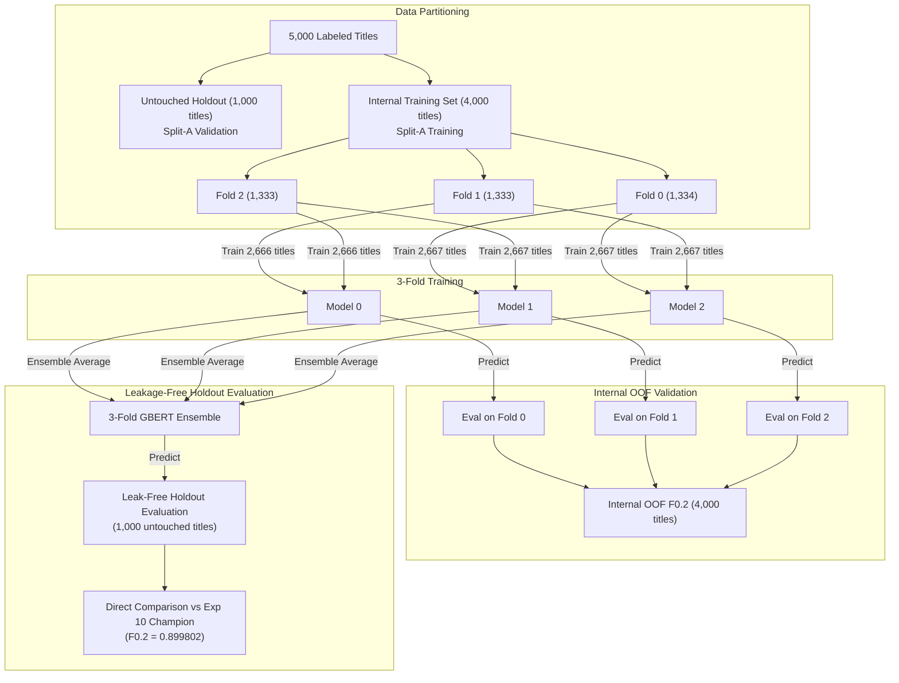

# Phase 29A: Cross-Validation Ensemble Feasibility & Experiment Design Report

**Date**: October 2026  
**Status**: **FEASIBILITY ANALYSIS COMPLETE** (Recommendation: 3-Fold Stratified GBERT Nested Pilot)  
**Current Verified Champion**: Exp 10 Ensemble with MIN 0.60 Confidence Threshold  
- **Architecture**: GBERT (0.40) + XLM-R Seed 42 (0.20) + XLM-R Seed 7 (0.20) + XLM-R Seed 21 (0.20)  
- **Official EvalAI Quiz $F_{0.2}$**: **0.901245410919943** (Rank 13)  
- **Local Split-A Validation $F_{0.2}$**: **0.899802**  
- **Inference Pipeline**: `src/submission/predict_test_champion.py` (Phase 28 verified, SHA-256: `049CF5EF...`)  
- **Git Checkpoint**: `ca38d5c`  

---

## 1. Executive Summary

Phase 29A investigates whether cross-validation (CV) training can introduce genuine model diversity to improve generalization beyond our frozen Exp 10 champion ($F_{0.2} = 0.901245$). 

### Key Findings
1. **Existing Experiments Audit**:
   None of our existing models are cross-validation models. The three XLM-R models (`xlmr_baseline_best`, `xlmr_seed_7_best`, `xlmr_seed_21_best`) were trained on the **identical 4,000 Split-A training titles** using different stochastic initialization and data shuffling seeds. We currently have **zero out-of-fold (OOF) predictions**.
2. **Leakage-Safe Architecture (Nested Holdout)**:
   Evaluating an ensemble of K-fold models on records that any constituent model was trained on constitutes severe training leakage. To evaluate a cross-validation ensemble scientifically, we must adopt a **Nested Holdout Paradigm**:
   - The **1,000 Split-A validation titles remain strictly untouched** as an independent holdout test set.
   - The **4,000 Split-A training titles** are partitioned into $K$ stratified internal folds.
   - The resulting $K$ fold models can then be ensembled and evaluated on the untouched 1,000-title holdout without a single token of training leakage, allowing direct, uncompromised comparison against our baseline champion ($F_{0.2} = 0.899802$).
3. **Hardware & Resource Boundaries**:
   - Drive C: free space is **6.86 GB**.
   - GBERT checkpoint size: **418.18 MB** per fold; training time: **~50 min**; peak VRAM: **2.07 GB**.
   - XLM-R checkpoint size: **1,079.69 MB (~1.08 GB)** per fold; training time: **~95 min**; peak VRAM: **3.50 GB**.
   - **XLM-R Cross-Validation is REJECTED on resource safety grounds**: A 5-fold XLM-R CV requires 5.40 GB of disk storage, which would leave $< 1.5$ GB on Drive C:, risking OS instability and disk exhaustion.
4. **Recommended Pilot**:
   A **3-Fold Stratified GBERT Cross-Validation Pilot** on the 4,000 Split-A training titles. Storage footprint is only **1.25 GB** ($3 \times 418$ MB), total training time is **~2.5 hours**, and evaluation against the untouched 1,000 Split-A holdout is 100% leakage-free.

---

## 2. Audit of Existing Experiments & Seed Variants

A comprehensive audit of all trained checkpoints, datasets, and previous phases reveals the following structural state:

| Checkpoint Name | Model Architecture | Training Data | Random Seed | Epochs | Checkpoint Size | Role in Champion Ensemble |
| :--- | :--- | :---: | :---: | :---: | :---: | :---: |
| `gbert_baseline_best` | `deepset/gbert-base` | Split A (4,000 titles) | 42 | 3 | 418.18 MB | **Champion (Weight 0.40)** |
| `xlmr_baseline_best` | `FacebookAI/xlm-roberta-base` | Split A (4,000 titles) | 42 | 2 | 1,079.69 MB | **Champion (Weight 0.20)** |
| `xlmr_seed_7_best` | `FacebookAI/xlm-roberta-base` | Split A (4,000 titles) | 7 | 3 | 1,079.69 MB | **Champion (Weight 0.20)** |
| `xlmr_seed_21_best` | `FacebookAI/xlm-roberta-base` | Split A (4,000 titles) | 21 | 2 | 1,079.69 MB | **Champion (Weight 0.20)** |
| `gbert_fulldata_seed42_final`| `deepset/gbert-base` | Full Data (5,000 titles)| 42 | 3 | 418.18 MB | Negative Result (Phase 22/23B) |
| `xlmr_fulldata_seed*_final` | `FacebookAI/xlm-roberta-base` | Full Data (5,000 titles)| 42, 7, 21 | 2–3 | 3,239.07 MB | Negative Result (Phase 22/23B) |
| `gelectra_baseline_best` | `deepset/gelectra-base` | Split A (4,000 titles) | 42 | 3 | 418.18 MB | Negative Result (Phase 25B) |

### Key Architectural Takeaways:
1. **Seed Variants $\ne$ Cross-Validation**:
   The three XLM-R models in our champion are **identical-data seed variants**. Each saw all 4,000 Split-A training titles. Their diversity arises solely from weight initialization and mini-batch sequence shuffling, not partition diversity.
2. **Zero Existing Out-of-Fold Predictions**:
   No models in the project history were trained using K-fold partition rotations. Therefore, no reusable out-of-fold predictions exist for the training set.
3. **The Single-GBERT Imbalance**:
   In the active champion ensemble, XLM-R benefits from 3-seed ensembling ($0.20 + 0.20 + 0.20 = 0.60$), whereas GBERT is represented by only a **single model instance** carrying a dominant 0.40 weight. If partition-based ensemble diversity is beneficial, GBERT is the most logical and resource-efficient candidate to test.

---

## 3. Leakage-Safe Evaluation Design

### 3.1 The Fundamental Leakage Pitfall: "Ensemble-on-Train"
When performing standard K-fold cross-validation across all 5,000 labeled titles:
- Model $k$ is trained on 4,000 titles (Folds $j \ne k$) and evaluated on Fold $k$ (1,000 titles).
- This produces an **Out-of-Fold (OOF)** prediction for individual models.
- **The Pitfall**: In competition inference, we do not deploy models individually; we **ensemble** them:
  $$P_{\text{ensemble}}(x) = \frac{1}{K} \sum_{k=1}^K P_k(x)$$
- If we evaluate $P_{\text{ensemble}}(x)$ on any title $x \in \text{Labeled Dataset}$, **$K - 1$ models in that ensemble were trained on $x$**.
- This leaks training labels into the evaluation metric, creating an artificial surge in precision and rendering local $F_{0.2}$ completely uninformative.

### 3.2 The Nested Holdout Paradigm (Clean & Scientific)
To evaluate a cross-validation ensemble rigorously without external EvalAI submissions, we structure the data as follows:

```
Total Labeled Data (N = 5,000 titles, records 1..5000)
├── [UNTOUCHED HOLDOUT TEST SET] (N = 1,000 titles, Split-A Validation, records 4001..5000)
│   └── NEVER seen by any fold model during training.
│   └── Evaluates: Standalone fold models, Internal CV Ensembles, and Full 6-Model Ensembles.
│   └── Direct baseline comparison against frozen Exp 10 (F0.2 = 0.899802).
│
└── [INTERNAL K-FOLD TRAINING SET] (N = 4,000 titles, Split-A Training, records 1..4000)
    ├── Fold 0: 1,334 titles (stratified by Category)
    ├── Fold 1: 1,333 titles (stratified by Category)
    └── Fold 2: 1,333 titles (stratified by Category)
```



### 3.3 Data Characteristics & Leakage Safeguards
1. **Category Stratification**:
   Every fold is stratified by `Category` ($Category \in \{1, 2\}$), guaranteeing that Category 1 (58.3%) and Category 2 (41.7%) proportions match the population.
2. **Title Duplication Audit**:
   Empirical audit of `data/raw/Tagged_Titles_Train.tsv.gz` confirms:
   - Total titles: 5,000.
   - **Unique exact titles: 5,000 (0 duplicates)**.
   - Normalized unique titles (lowercased, whitespace-stripped): 4,999 (only 1 near-duplicate pair).
   - *Conclusion*: Cross-fold title duplication leakage is virtually non-existent.
3. **Guarding Against Split-A Overfitting**:
   Split A has been tested across Experiments 10–28. By computing **both** the internal OOF metric across 4,000 training titles and the holdout metric on 1,000 titles, we obtain a dual validation signal that protects against split-specific artifacts.

---

## 4. Hardware & Resource Feasibility Audit

### 4.1 System Resource Inventory
- **Host GPU**: NVIDIA GeForce GTX 1660 Ti (6.00 GB GDDR6 VRAM, Compute Capability 7.5).
- **Available Drive C: Space**: **6.86 GB free**.
- **Minimum Safe Free Space Threshold**: **3.50 GB** (required for OS pagefile, PyTorch CUDA kernels, and temporary write caches).
- **Usable Disk Budget for New Checkpoints**: $6.86 - 3.50 = \mathbf{3.36\text{ GB}}$ maximum.

### 4.2 Resource Profile by Model Architecture

| Parameter | `deepset/gbert-base` (WordPiece) | `FacebookAI/xlm-roberta-base` (SentencePiece) |
| :--- | :---: | :---: |
| **Model Size on Disk** | **418.18 MB** | **1,079.69 MB (~1.08 GB)** |
| **Training Memory (Batch Size = 4)** | **2.07 GB VRAM** | **3.50 GB VRAM** |
| **Training Speed (GTX 1660 Ti)** | ~80 titles/sec (~16 min/epoch) | ~50 titles/sec (~28 min/epoch) |
| **Training Duration (3 Epochs, 2,667 titles)** | **~48 minutes** | **~85 minutes** |
| **Storage per 3 Folds** | **1.25 GB** (Safe: 18% of free disk) | **3.24 GB** (Risky: 47% of free disk) |
| **Storage per 5 Folds** | **2.09 GB** (Safe: 30% of free disk) | **5.40 GB** (**CRITICAL RISK: 79% of free disk**) |

> [!CAUTION]
> **XLM-R Cross-Validation is Storage-Prohibitive**:  
> Running a 5-fold XLM-R cross-validation requires 5.40 GB for weights alone, which would leave only 1.46 GB on Drive C:. This violates our preflight safety limits and risks catastrophic OS failure. Even a 3-fold XLM-R CV consumes 3.24 GB, leaving very little margin.

---

## 5. Comparative Evaluation of Experiment Designs

| Dimension | Design A: 3-Fold GBERT CV | Design B: 5-Fold GBERT CV | Design C: Cross-Val XLM-R | Design D: 1 Additional GBERT Seed |
| :--- | :--- | :--- | :--- | :--- |
| **Partitioning Scheme** | 3 stratified folds on 4k train set | 5 stratified folds on 4k train set | 3 or 5 folds on XLM-R | Split A (4k train) with seed 7 |
| **Training Examples / Fold** | 2,667 titles (66.7% of Split A) | 3,200 titles (80.0% of Split A) | 2,667 or 3,200 titles | 4,000 titles (100% of Split A) |
| **Models Trained** | 3 models | 5 models | 3 or 5 models | 1 model |
| **Disk Storage** | **1.25 GB** | **2.09 GB** | **3.24 – 5.40 GB** | **0.42 GB** |
| **Estimated Training Time** | **~2.4 hours** | **~4.2 hours** | **~4.5 – 7.5 hours** | **~0.8 hours** |
| **Validation Architecture** | Internal OOF + Untouched Holdout | Internal OOF + Untouched Holdout | Internal OOF + Untouched Holdout | Untouched Holdout |
| **Potential Benefit** | Partition diversity for GBERT | Higher training data per fold | Partition diversity for XLM-R | Seed diversity for GBERT |
| **Principal Risks** | Training on 2,667 titles may lower base token representation quality | Long runtime (4.2h); diminishing returns over 3-fold | **Severe disk exhaustion risk** ($> 5.4$ GB); redundant with existing 3 seeds | No partition diversity (identical 4,000 training titles) |
| **Feasibility Verdict** | **HIGHLY FEASIBLE (RECOMMENDED)** | **FEASIBLE (High runtime)** | **REJECTED (Storage Danger)** | **FEASIBLE (Alternative)** |

---

## 6. Recommended Pilot Experiment: 3-Fold Stratified GBERT Pilot

### 6.1 Scientific Justification
1. **Minimal & Bounded**: 3 folds is the smallest complete cross-validation configuration that generates a full out-of-fold prediction across all 4,000 training records.
2. **Safe Resource Footprint**:
   - $3 \times 418.18\text{ MB} = 1.25\text{ GB}$ storage. Drive C: free space will remain comfortably $> 5.5$ GB.
   - Peak VRAM is only 2.07 GB on batch size 4.
   - Total runtime is bounded at ~2.4 hours.
3. **Addresses the Core Ensemble Asymmetry**:
   Our frozen champion has 3 diverse XLM-R models, but only **1 GBERT model**. Ensembling 3 diverse GBERT fold models with the 3 XLM-R models creates a balanced, highly robust 6-model ensemble.

### 6.2 Exact Pilot Specifications

#### Data Partitions
- **Untouched Holdout Set**: 1,000 titles from Split A (Category 1: 583 titles, Category 2: 417 titles). Never touched by any fold model.
- **Internal Folds (from 4,000 Split-A training records)**:
  - **Fold 0**: 1,334 titles (Cat 1: 778, Cat 2: 556)
  - **Fold 1**: 1,333 titles (Cat 1: 777, Cat 2: 556)
  - **Fold 2**: 1,333 titles (Cat 1: 777, Cat 2: 556)

#### Training Configurations
All 3 models use the frozen, verified hyperparameters:
- Base Architecture: `deepset/gbert-base`
- Epochs: 3
- Learning Rate: $2 \times 10^{-5}$ (AdamW, linear warmup)
- Batch Size: 4 (train), 8 (val)
- Max Sequence Length: 512
- Model 0: Trained on Folds 1+2 (2,666 titles) $\rightarrow$ Best checkpoint: `checkpoints/gbert_cv3_fold0_best`
- Model 1: Trained on Folds 0+2 (2,667 titles) $\rightarrow$ Best checkpoint: `checkpoints/gbert_cv3_fold1_best`
- Model 2: Trained on Folds 0+1 (2,667 titles) $\rightarrow$ Best checkpoint: `checkpoints/gbert_cv3_fold2_best`

#### Checkpoint Retention Strategy
- Only the **best validation checkpoint** per fold (based on fold validation $F_{0.2}$) is saved.
- Optimizer states and intermediate epoch checkpoints are discarded immediately after each epoch.
- Probability caches (`.npy`) used during evaluation are deleted immediately upon metric computation.

#### 4-Step Evaluation Procedure
1. **Step 1: Internal OOF Evaluation**:
   Concatenate the out-of-fold validation predictions across Folds 0, 1, and 2. Compute official-style $F_{0.2}$ across all 4,000 training titles.
2. **Step 2: Holdout Evaluation of Individual Folds**:
   Evaluate Model 0, Model 1, and Model 2 individually on the untouched 1,000 Split-A holdout. Measure the impact of training on 2,667 vs 4,000 records.
3. **Step 3: GBERT-Only CV Ensemble on Holdout**:
   Fuse probabilities from Model 0, Model 1, and Model 2 ($\frac{1}{3}$ each) on the untouched 1,000 Split-A holdout. Test if CV ensembling recovers/exceeds the single GBERT baseline ($F_{0.2} = 0.867200$).
4. **Step 4: Full 6-Model Challenger Ensemble on Holdout**:
   Evaluate the challenger ensemble on the untouched 1,000 Split-A holdout with MIN 0.60 confidence filter:
   $$P_{\text{challenger}} = 0.40 \times \left( \frac{1}{3} P_{\text{GB0}} + \frac{1}{3} P_{\text{GB1}} + \frac{1}{3} P_{\text{GB2}} \right) + 0.20 P_{\text{XLM42}} + 0.20 P_{\text{XLM7}} + 0.20 P_{\text{XLM21}}$$
   Compare directly against the frozen champion baseline ($F_{0.2} = 0.899802$).

#### Explicit Stopping Criteria
- **Abort Condition 1**: If any individual fold model exhibits severe degradation on the holdout ($F_{0.2} < 0.840$, indicating 2,667 titles is insufficient for GBERT token classification).
- **Abort Condition 2**: If the 6-model challenger fails to beat or match the frozen champion ($0.899802$) on the holdout.
- **Safety Abort**: If free disk space on Drive C: drops below **4.0 GB** at any point during training.

---

## 7. Restrictions & Safety Compliance
- **Zero Model Training**: Phase 29A is strictly an analytical feasibility study. No training scripts were launched.
- **Zero EvalAI Submissions**: No submissions prepared or sent.
- **Frozen Assets Untouched**: All 4 champion checkpoints and submission TSVs remain preserved.
- **Test Pipeline Frozen**: `src/submission/predict_test_champion.py` remains unchanged.
- **Disk Space Preserved**: Drive C: free space remains at **6.86 GB**.
