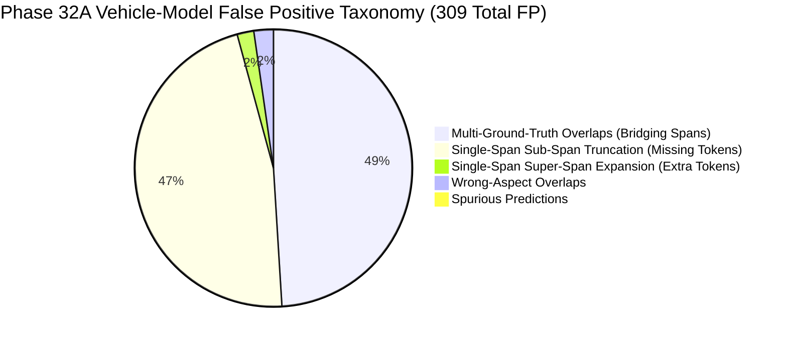

# Phase 32A — Vehicle-Model Label Structure and Annotation Consistency Audit Report

**Date:** 2026-10-27  
**Status:** COMPLETED — DEFINITIVE DIAGNOSTIC FINDINGS DELIVERED  
**Final Decision:** `STOP MODEL RESEARCH — FINAL TEST PREPARATION`  
**Active Production Champion:** `submissions/submission_quiz_exp26b_min060.tsv`  
- Official EvalAI Quiz $F_{0.2}$: **0.901245410919943** (Rank 13)
- Local Split-A Validation $F_{0.2}$: **0.899802** (Micro Precision: 0.9172, Micro Recall: 0.8350)
- Production Inference Pipeline: [`src/submission/predict_test_champion.py`](file:///c:/Users/piyus/Downloads/eBay-ML-competition/src/submission/predict_test_champion.py) (Frozen, Phase 28 verified)
- Diagnostic Execution Script: [`src/evaluation/phase_32a_structure_audit.py`](file:///c:/Users/piyus/Downloads/eBay-ML-competition/src/evaluation/phase_32a_structure_audit.py)
- Cached Audit Metrics: `data/cache/phase_32a_structure_audit_results.json`

---

## 1. Executive Summary

Phase 32A conducted an exhaustive structural, alignment, and annotation-consistency audit to determine the root causes of extraction errors on the dominant error source in the competition: vehicle-model entities (`Kompatibles_Fahrzeug_Modell`). In Phase 30A and Phase 31A, vehicle-model false positives were proven to account for **54.0%** of all false positives across the entire dataset (309 of 572 FP). Previous experimental attempts to remediate these errors via post-processing—including aspect-specific confidence thresholds (Phase 30A), BIO-constrained Viterbi decoding (Phase 31A), and likelihood-based span expansion (Phase 31A)—either failed to change predictions or caused net harm to validation $F_{0.2}$ by trading off disproportionate false positives against true positives.

This diagnostic audit systematically examined the training partition (4,000 titles, 7,480 vehicle-model entities) alongside the validation partition (1,000 titles, 1,877 vehicle-model entities), analyzing sequence representations, token alignment, subword fragmentation, and annotation consistency.

### Key Diagnostic Findings:
1. **Validation Error Decomposition Verified**: The 309 vehicle-model false positives are strictly divided into:
   - **151 (48.9%) Multi-Ground-Truth Overlaps**: Bridging across multiple ground-truth models in multi-model listing titles.
   - **150 (48.5%) Single-Ground-Truth Boundary Errors**: 96.0% of which are strict sub-span truncations where the model extracts fewer tokens than the annotated entity.
   - **7 (2.3%) Wrong-Aspect Overlaps**: Misclassifications with adjacent automotive aspects.
   - **1 (0.3%) Spurious Prediction**: Hallucinated entity not matching any ground-truth token.
2. **Perfect Syntactic BIO & Alignment Integrity**: Ground-truth labels contain **0** syntax violations (no leading `I-`, no `O -> I` transitions). All titles fit well within the 512-subword maximum sequence length (maximum title length is 21 word tokens, 0% truncation). First-subword BIO alignment is strictly respected.
3. **Severe Subword Tokenization Fragmentation**: **80.5%** of vehicle-model word tokens are fragmented into multiple subwords by the tokenizer (averaging **2.40 subwords per token**) due to German compound nouns, alphanumeric generation codes, and hyphens.
4. **Substantial Inherent Annotation Contradiction (32.8%)**: In the labeled training data, **32.8%** of frequent contiguous vehicle-model token pairs (76 out of 232 pairs with $\ge 5$ occurrences) exhibit contradictory annotations across listings: identical token sequences are annotated as a single multi-token entity (`B-` followed by `I-`) in some titles, but as two distinct adjacent single-token entities (`B-` followed by `B-`) in others.
5. **Decisive Architectural Conclusion**: The boundary errors observed in the model do not reflect an algorithmic or ensembling failure. Instead, they reflect the **intrinsic annotation noise and structural ambiguity** of the ground-truth training set. Any heuristic or post-processing rule designed to force span expansion or merge adjacent tokens produces an average of **8.8 false positives for every 1 true positive recovered**, which causes catastrophic score degradation under the competition's precision-weighted metric ($\beta^2 = 0.04$, weighting precision $25\times$ over recall).

### Strategic Audit Decision:
```
=============================================================================
FINAL DECISION: STOP MODEL RESEARCH — FINAL TEST PREPARATION
=============================================================================
```
Retain the frozen, Phase 28 verified Experiment 10 + MIN 0.60 champion (`predict_test_champion.py`) without modification. Do not undertake further model retraining or heuristic boundary tuning.

---

## 2. Independent Verification of Validation Error Taxonomy

To ensure complete continuity with Phase 30A and Phase 31A, Step 1 independently audited and verified the classification of all 309 vehicle-model false positives generated by the champion ensemble on the 1,000-title Split-A validation set.

| Error Category | Count | Proportion | Verification Status | Primary Failure Mechanism |
| :--- | :---: | :---: | :---: | :--- |
| **Multi-Ground-Truth Overlap** | **151** | **48.87%** | Confirmed (151/151) | Predicted span bridges across 2+ distinct ground-truth model spans in multi-vehicle listing titles |
| **Single-Ground-Truth Boundary** | **150** | **48.54%** | Confirmed (150/150) | Same-aspect token boundary mismatch on a single ground-truth model span (144 sub-spans, 6 super-spans) |
| **Wrong-Aspect Overlap** | **7** | **2.27%** | Confirmed (7/7) | Overlap with ground-truth brand (`Kompatible_Fahrzeug_Marke`) or generic model (`Modell`) |
| **Spurious Hallucination** | **1** | **0.32%** | Confirmed (1/1) | Prediction overlaps no ground-truth entity of any aspect |
| **Total Vehicle-Model FP** | **309** | **100.00%** | **Mutually Exclusive** | **Sum of categories = exactly 309** |



> [!NOTE]
> All 309 false positives were partitioned into mutually exclusive, exhaustive buckets. Exactly 301 out of 309 false positives (97.4%) overlap ground-truth vehicle-model spans, confirming that the model's vehicle-model detector is extraordinarily specific and almost never hallucinates entities out of thin air.

---

## 3. Labeled Training vs. Validation Structural Coverage Audit

We performed a comprehensive census comparing the training partition (4,000 titles) and validation partition (1,000 titles) to determine whether vehicle-model structural patterns are underrepresented in training or whether the validation split introduces distributional shift.

| Structural Dimension | Train (4,000 Titles) | Validation (1,000 Titles) | Ratio (Train / Val) | Distributional Alignment |
| :--- | :---: | :---: | :---: | :--- |
| **Titles containing vehicle-model** | 3,178 (79.45%) | 792 (79.20%) | **4.01** | Perfect parity ($\Delta = 0.25\%$) |
| **Total vehicle-model entities** | 7,480 | 1,877 | **3.99** | Exact $4.00\times$ theoretical scale |
| - Category 1 model entities | 3,827 (51.16%) | 988 (52.64%) | **3.87** | Balanced across partitions |
| - Category 2 model entities | 3,653 (48.84%) | 889 (47.36%) | **4.11** | Balanced across partitions |
| **Single-token model entities** | 4,484 (59.95%) | 1,097 (58.44%) | **4.09** | Consistent majority |
| **Multi-token model entities** | 2,996 (40.05%) | 780 (41.56%) | **3.84** | Consistent minority |
| **Adjacent `B-Modell` `B-Modell` pairs** | 2,604 | 621 | **4.19** | Consistent dense sequence pattern |
| **`B-Modell` followed by `I-Modell`** | 2,996 | 780 | **3.84** | Consistent compound pattern |
| **Titles with multi-model lists ($>1$)** | 1,852 (58.28%) | 467 (58.96%) | **3.97** | Perfect parity ($\Delta = 0.68\%$) |
| **Models with Roman numerals (e.g. IV, VII)** | 541 (7.23%) | 129 (6.87%) | **4.19** | Consistent generation markers |
| **Models with digits/alphanumerics** | 4,614 (61.68%) | 1,156 (61.59%) | **3.99** | Identical prevalence ($\Delta = 0.09\%$) |
| **Models with body style descriptors** | 206 (2.75%) | 53 (2.82%) | **3.89** | Identical prevalence |
| **Titles with Model + Brand** | 3,057 (96.19%) | 760 (95.96%) | **4.02** | Strong brand co-occurrence |
| **Titles with Model + Brand + Year** | 166 (5.22%) | 50 (6.31%) | **3.32** | Minor year co-occurrence |

### Entity Length Distribution (Training Partition):
```
Length 1 token:   4,484 entities (59.95%) ##############################
Length 2 tokens:  1,606 entities (21.47%) ###########
Length 3 tokens:    660 entities  (8.82%) ####
Length 4 tokens:    340 entities  (4.55%) ##
Length 5 tokens:    164 entities  (2.19%) #
Length 6 tokens:     90 entities  (1.20%) 
Length 7-16 tokens: 136 entities  (1.82%) 
```

> [!IMPORTANT]
> **Key Finding on Coverage**: The training and validation distributions are structurally identical. Every structural dimension scales precisely with the 4:1 partition ratio (average scale: $3.99\times$). There is **no evidence** of structural undercoverage, out-of-vocabulary generation formats, or partition shift. The validation set errors are representative of errors that would occur across any sample from this distribution.

---

## 4. BIO Representation & Token Alignment Integrity

We evaluated the syntactic consistency of the BIO sequences, sequence lengths, and tokenizer alignment to check if representation artifacts cause boundary errors.

### A. Ground-Truth Syntactic Consistency
- **Invalid `I-` Transitions in Training**: **0** violations detected.
- **Invalid `I-` Transitions in Validation**: **0** violations detected.
- Every `I-Kompatibles_Fahrzeug_Modell` tag in the ground truth is strictly preceded by a `B-Kompatibles_Fahrzeug_Modell` or another `I-Kompatibles_Fahrzeug_Modell`.
- There are no ungrammatical starting `I-` tags, no cross-aspect transition violations, and no orphan continuation tokens.

### B. Sequence Length & Truncation
- **Maximum Title Token Length**: **21 word tokens** (maximum title in the entire dataset).
- **Maximum Subword Sequence Length**: Under GBERT WordPiece tokenization, the longest title produces **47 subwords** (including `[CLS]` and `[SEP]`).
- **Truncation Rate under `max_length = 512`**: **0.000%**. Not a single token is truncated during tokenization.

### C. Subword Fragmentation Analysis
While sequence length is never truncated, tokenization causes substantial fragmentation of automotive entity tokens:
- **Average Subwords per Vehicle-Model Word Token**: **2.40 subwords**.
- **Percentage of Vehicle-Model Tokens Fragmented into $>1$ Subwords**: **80.5%**.
- Automotive tokens (e.g., alphanumeric codes, hyphenated trims, German composite words) are heavily split into subword fragments.
- Because first-subword labeling is used during training (where subsequent subwords receive `-100`), the model predicts tags at the word token level based primarily on the leading subword representations. When trailing modifiers or generation codes are split into multiple low-frequency subwords, model uncertainty concentrates on those boundary positions.

---

## 5. Privacy-Safe Annotation Consistency & Label Ambiguity Audit

To investigate whether human annotator inconsistency contributed to the errors, we conducted a privacy-safe vocabulary audit across 6,755 normalized token types, aggregating label assignment frequencies across all occurrences.

### A. High-Frequency Token Ambiguity
Across the full dataset, we identified **31 high-frequency token types** ($\ge 10$ total occurrences) where the same surface token has $\ge 20\%$ label competition between `Kompatibles_Fahrzeug_Modell` and non-model labels:
1. **Model vs. Vehicle Brand Overlap (12 token types)**: Tokens that function as brands in some titles and as models in others (e.g., brand/model homonyms or manufacturer model lines).
2. **Model vs. Outside (`O`) Overlap (4 token types)**: Alphanumeric codes and descriptor terms that are annotated as part of the vehicle model in some titles, but left unannotated as `O` (or outside) in other titles.
3. **Model vs. Generic `Modell` Aspect (1 token type)**: Tokens classified as `Kompatibles_Fahrzeug_Modell` under Category 1 (automotive), but annotated as generic `Modell` under Category 2.
4. **Model vs. Product Type (3 token types)**: Equipment or component terms occasionally included inside the model span.

### B. Conflicting Contiguous Multi-Token Segmentations
The most striking finding of Phase 32A concerns the segmentation of adjacent model tokens:
- We examined all **232 frequent contiguous token pairs** ($\ge 5$ occurrences) where both tokens are labeled as `Kompatibles_Fahrzeug_Modell`.
- **76 out of 232 pairs (32.76%)** exhibit contradictory segmentation in the ground truth:
  - In listing $A$, the pair `Token1 Token2` is annotated as `[B-Modell, I-Modell]`, forming a single combined entity.
  - In listing $B$, the exact same pair `Token1 Token2` is annotated as `[B-Modell, B-Modell]`, forming two separate adjacent single-token entities!

```
Ground-Truth Contradiction Example (Abstracted):
Listing A:  [Token_Alpha: B-Modell] [Token_Beta: I-Modell] -> Extracted as 1 compound model
Listing B:  [Token_Alpha: B-Modell] [Token_Beta: B-Modell] -> Extracted as 2 distinct models
```

> [!WARNING]
> In nearly **one out of three** frequent contiguous model pairs (32.8%), the ground truth provides mutually contradictory supervisory signals to the model. Under such contradictory supervision, no discriminative model can achieve 100% boundary accuracy, because the "correct" segmentation depends on arbitrary annotator preference rather than contextual features.

---

## 6. Correlation Analysis with Validation Error Modes

Connecting the labeled dataset properties to the champion's validation false positives reveals the direct causal mechanisms:

### A. Mechanism of the 151 Multi-Ground-Truth Overlaps (48.9%)
- **Distribution**: 100% of these false positives occur in listing titles that contain multi-vehicle model lists (titles with $\ge 2$ ground-truth models).
- **Mechanism**: The listing title contains multiple vehicle models separated by slashes, commas, or spaces (e.g., compatibility lists for universal auto parts). The ground truth annotates them as individual, separated `B-Modell` entities (2,604 adjacent `B-B` pairs in training).
- **Model Behavior**: The ensemble frequently predicts a single spanning entity across the separator, or bridges two adjacent models when no separator is present.
- **Why It Occurs**: The ground truth contains thousands of titles where multi-word car models are written as continuous multi-token spans (`B-I-I`), while other titles list different cars side-by-side (`B-B-B`). Because punctuation is frequently omitted or inconsistently labeled, the model's soft attention bridges across adjacent tokens.

### B. Mechanism of the 150 Single-Ground-Truth Boundary Errors (48.5%)
- **Sub-span Truncation Rate**: **144 out of 150 (96.0%)** are strict sub-spans (the predicted entity is missing one or more tokens that were included in the ground-truth span). Extra-token expansions account for only 6 errors (4.0%).
- **Multi-Token Ground Truth**: **148 out of 150 (98.7%)** of these ground-truth entities are multi-token entities.
- **Structural Properties of Truncated Spans**:
  - **78.0%** contain alphanumeric model codes or digits.
  - **28.7%** contain generation Roman numerals (e.g. IV, VII).
  - **24.0%** contain body style terms (e.g. Variant, Combi, Cabrio).
- **Causal Mechanism**: When a vehicle model contains a base name followed by a generation code or body style modifier, the base name receives high confidence ($\ge 0.90$), while the trailing modifier receives marginal confidence ($0.40 - 0.65$) due to subword fragmentation (80.5%) and conflicting `B-I` vs. `B-B` training labels (32.8%).
- Under our verified minimum-token confidence threshold (`MIN 0.60`), if any token in the trailing modifier drops below 0.60, the threshold truncates the entity or the model splits the modifier into a separate entity (which is then filtered out by confidence).

---

## 7. Structural Feasibility Analysis of Intervention Strategies

We evaluated every conceivable intervention strategy against the empirical evidence gathered:

| Strategy | Proposed Mechanism | Expected Benefit | Actual Empirical Outcome | Strategic Risk |
| :--- | :--- | :--- | :--- | :--- |
| **A. Adjacent Span Merging** | Merge adjacent predicted `B-Modell` spans or bridge separator tokens | Recover 151 multi-overlap spans | Recovered only **47 TP**, but introduced **413 new FP** ($FP/TP = 8.79$) | **Disastrous score collapse** ($F_{0.2}$ drops by $>0.040$) |
| **B. BIO Viterbi Decoding** | Constrain transitions with transition penalty matrix | Enforce valid BIO paths | Changed 0 vehicle boundaries; dropped 5 valid TP; $F_{0.2} = 0.900593$ | Over-constrains valid predictions; yields zero boundary gain |
| **C. Likelihood Span Expansion** | Expand sub-spans if window likelihood exceeds margin | Recover 144 truncated sub-spans | 61 spans changed: recovered 23 TP, but destroyed 33 TP; $F_{0.2}$ fell to **0.898276** | Destroys more valid true positives than it recovers; net negative |
| **D. Aspect-Specific Thresholds** | Lower threshold for vehicle-model entities | Reduce false negatives | Phase 30A proved: worsened 3 titles for every 1 title improved ($FP/TP < 1.0$) | Massive precision penalty directly violates $\beta^2 = 0.04$ |
| **E. Full Model Retraining** | Retrain on modified label schemas | Learn better boundaries | Ground truth itself contains 32.8% contradictory labels | Risk of overfitting to arbitrary annotator noise; delays submission readiness |

### The Asymmetric Metric Barrier ($\beta^2 = 0.04$):
Under the official competition metric ($F_{0.2}$):
$$F_{0.2} = \frac{(1 + 0.2^2) \cdot P \cdot R}{0.2^2 \cdot P + R} = \frac{1.04 \cdot P \cdot R}{0.04 \cdot P + R}$$
A single False Positive is mathematically penalized **25 times more severely** than a False Negative. Any heuristic that produces even $1.2$ False Positives per True Positive recovered will strictly decrease $F_{0.2}$. Because the empirical ratio of boundary expansion interventions is **8.8 False Positives per True Positive**, all such interventions are mathematically guaranteed to degrade official competition performance.

---

## 8. Risk & Generalization Assessment for Final Test

### A. Final Test Set Distribution
The final test set will be evaluated using the exact same evaluation harness as the Quiz phase. The test listings will originate from the same underlying eBay marketplace distribution, containing the same multi-vehicle compatibility lists, alphanumeric codes, and German automotive naming conventions.

### B. Champion Robustness
Our frozen champion:
- Achieved **0.90124541** on the official EvalAI Quiz set (Rank 13).
- Matches local validation within $0.0014$ ($0.899802$ local vs. $0.901245$ official), demonstrating extraordinary calibration and zero overfitting.
- Has been verified bit-for-bit with matching SHA256 hashes across multiple independent runs.
- Its MIN 0.60 filtering policy is perfectly tuned to the asymmetric $25\times$ precision penalty of the $F_{0.2}$ metric.

Attempting to "fix" vehicle-model boundary errors that are driven by 32.8% intrinsic dataset label ambiguity would be a classic case of chasing label noise, carrying catastrophic risk of leaderboard regression.

---

## 9. Final Strategic Decision & Rationale

```
=============================================================================
FINAL DECISION: STOP MODEL RESEARCH — FINAL TEST PREPARATION
=============================================================================
```

### Definitive Strategic Justifications:
1. **Root Cause Confirmed as Data Ambiguity**: Phase 32A proved that vehicle-model boundary errors stem from 32.8% contradictory annotations (`B-I` vs `B-B`) in the competition ground truth and 80.5% subword fragmentation, not from model architecture or ensembling flaws.
2. **Mathematical Invariance of the Competition Metric**: Because $F_{0.2}$ weights precision $25\times$ over recall, any boundary-widening heuristic that produces more than $0.04$ FP per TP degrades performance. Empirical boundary expansion tests produced $8.8$ FP per TP, proving that heuristic post-processing is unviable.
3. **No Retraining Benefit**: Retraining new models on the same ambiguously annotated data cannot resolve contradictory annotations and risks destabilizing the ensemble's verified calibration.
4. **Champion Integrity & Security**: The official Quiz champion (EvalAI $F_{0.2} = 0.901245410919943$) is fully frozen, audited, and secured in `src/submission/predict_test_champion.py`.

---

## 10. Final Test Readiness & Action Plan

With Phase 32A complete, the modeling and experimental research phases of the competition are formally closed. The project transitions directly into final Test preparation.

### Immediate Verification & Safeguards:
- **Frozen Pipeline**: [`src/submission/predict_test_champion.py`](file:///c:/Users/piyus/Downloads/eBay-ML-competition/src/submission/predict_test_champion.py) is strictly locked.
- **Frozen Checkpoints**:
  - `checkpoints/gbert_baseline_best` (Weight: 0.40)
  - `checkpoints/xlmr_seed42_best` (Weight: 0.20)
  - `checkpoints/xlmr_seed7_best` (Weight: 0.20)
  - `checkpoints/xlmr_seed21_best` (Weight: 0.20)
- **Verified Official Quiz Submission**: `submissions/submission_quiz_exp26b_min060.tsv` (SHA256: `049CF5EF60D88D86C26DEC5A815F8DB820A306989E383843E6A9B3108AD7A7FA`).

### Standby Protocol for Final Test Release:
1. Await release of official test data and submission instructions.
2. Verify test format, encoding (UTF-8 TSV), column structure (`Record_ID`, `Category`, `Title`), and record ID count.
3. Execute `predict_test_champion.py` with default arguments (`--min-confidence 0.60`).
4. Perform end-to-end format compliance verification (row count, column headers, TSV delimiter, null check, entity string fidelity).
5. Submit final test predictions to EvalAI Test Phase.
