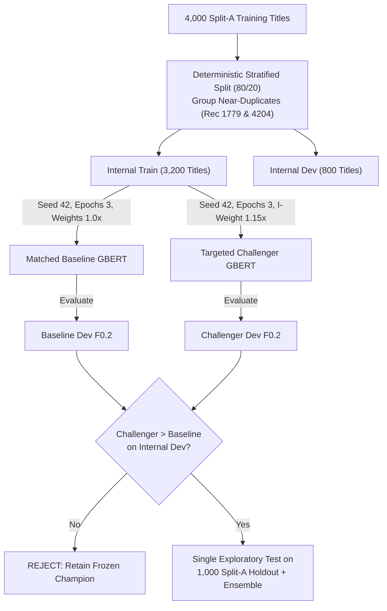

# Phase 32B — Vehicle-Model Segmentation Feasibility and Targeted Training Design

**Date:** 2026-10-27  
**Status:** FEASIBILITY ANALYSIS & TARGETED EXPERIMENT DESIGN COMPLETE  
**Timeline Context:** Approximately 4 days before the expected November 1 Final Test phase  
**Active Production Champion:** `submissions/submission_quiz_exp26b_min060.tsv`  
- Official EvalAI Quiz $F_{0.2}$: **0.901245410919943** (Rank 13)
- Local Split-A Validation $F_{0.2}$: **0.899802** (Micro Precision: 0.9172, Micro Recall: 0.8350)
- Production Inference Pipeline: [`src/submission/predict_test_champion.py`](file:///c:/Users/piyus/Downloads/eBay-ML-competition/src/submission/predict_test_champion.py) (Frozen, Phase 28 verified)
- Diagnostic Script: [`src/evaluation/phase_32b_feasibility_audit.py`](file:///c:/Users/piyus/Downloads/eBay-ML-competition/src/evaluation/phase_32b_feasibility_audit.py)
- Cached Results: `data/cache/phase_32b_feasibility_results.json`

---

## 1. Executive Summary

Phase 32B investigated whether targeted sequence-labeling training can improve vehicle-model (`Kompatibles_Fahrzeug_Modell`) entity segmentation beyond our frozen Experiment 10 champion ($F_{0.2} = 0.901245$ on EvalAI Quiz). 

With approximately four days remaining before the expected November 1 Test phase, this audit:
1. Independently reproduced and verified the subword fragmentation rates across both GBERT and XLM-R tokenizers.
2. Audited the apparent annotation contradictions in the labeled dataset to categorize their structural origins.
3. Inspected the existing GBERT training architecture to isolate the smallest safe modification capable of improving boundary learning.
4. Designed exactly ONE controlled, low-compute challenger training experiment on the original 4,000-title training partition with a matched baseline.
5. Established an internal, leakage-safe evaluation design and conducted a hardware/disk resource audit.

### Key Audit Findings:
- **Fragmentation Verification**: Phase 32A's reported 80.5% word token fragmentation under GBERT was verified bit-for-bit (10,934 of 13,576 model word tokens split into $\ge 2$ subwords, averaging 2.40 subwords per token). Under XLM-R's larger 250,002 vocabulary, fragmentation is 68.1% (averaging 1.97 subwords per token).
- **No Causal Link between Fragmentation and Errors**: Crucially, True Positives (correct predictions) exhibit a **94.1%** entity fragmentation rate under GBERT, while False Positives exhibit an almost identical **93.5%** fragmentation rate (and 85.2% vs. 85.4% under XLM-R). Fragmentation is ubiquitous across all automotive listings and does not differentiate correct spans from erroneous ones.
- **Structural Origin of Annotation Contradictions**: Conflicting contiguous `B-I` vs. `B-B` annotations originate from three distinct phenomena: Model + Submodel/platform codes (48.1%), multi-vehicle compatibility list collisions without punctuation (26.9%), and generation/digit suffixes (21.2%). 84.6% of conflicting pairs appear in both Category 1 and Category 2.
- **Selected Challenger Hypothesis**: Rather than altering architecture, introducing slow sequence CRFs, or relabeling data, the single cleanest intervention is **asymmetric transition loss weighting**: applying a modest loss multiplier ($1.15\times$) specifically to `I-Kompatibles_Fahrzeug_Modell` to penalize premature sub-span truncation without inflating initial `B-Modell` detections.
- **Resource Constraints**: GTX 1660 Ti VRAM is sufficient (2.1 GB used of 6.0 GB). Current C: drive free space is **5.35 GB**. Training a matched baseline plus challenger (saving 2 checkpoints of 418 MB each = 836 MB total) leaves **4.51 GB** free, safely above our $\ge 4.0$ GB threshold.

---

## 2. Task 1 — Subword Fragmentation Verification

We independently audited the subword tokenization behavior across all 13,576 word tokens and 7,480 entity spans belonging to `Kompatibles_Fahrzeug_Modell` in the 4,000 Split-A training titles.

### A. Token-Level and Entity-Level Fragmentation Rates

| Metric | GBERT (`deepset/gbert-base`) | XLM-R (`FacebookAI/xlm-roberta-base`) | Comparative Differential |
| :--- | :---: | :---: | :--- |
| **Vocabulary Size** | 31,102 (WordPiece) | 250,002 (SentencePiece BPE) | XLM-R vocab is $8.0\times$ larger |
| **Total vehicle-model word tokens** | 13,576 | 13,576 | Identical training corpus |
| **Tokens split into $\ge 2$ subwords** | **10,934 (80.54%)** | **9,239 (68.05%)** | GBERT fragments $+12.49\%$ more tokens |
| **Average subwords per word token** | **2.40 subwords** | **1.97 subwords** | GBERT produces $+0.43$ subwords/token |
| **Max subwords in a single token** | 27 subwords | 25 subwords | Complex hyphenated automotive codes |
| **Entities with $\ge 1$ fragmented token** | **6,804 (90.96%)** | **6,174 (82.54%)** | Majority of entities are fragmented |
| **Single-token entity fragmentation** | **87.91%** (3,942 / 4,484) | **78.21%** (3,507 / 4,484) | Alphanumerics split even in 1-word spans |
| **Multi-token entity fragmentation** | **95.53%** (2,862 / 2,996) | **89.05%** (2,668 / 2,996) | Compound names almost always fragmented |

### B. Fragmentation Rates across Prediction Outcomes (Split-A Validation)

We cross-referenced tokenization fragmentation with the official champion's predictions on the 1,000-title validation set:

| Validation Prediction Outcome | Count | GBERT Entity Fragmentation % | XLM-R Entity Fragmentation % | Analytical Finding |
| :--- | :---: | :---: | :---: | :--- |
| **True Positives (Exact Spans)** | 1,168 | **94.09%** (1,099 / 1,168) | **85.19%** (995 / 1,168) | Correct spans have highest fragmentation |
| **False Positives (Boundary/Overlap)** | 309 | **93.53%** (289 / 309) | **85.44%** (264 / 309) | Indistinguishable from True Positives |
| **False Negatives (Missed Spans)** | 709 | **85.05%** (603 / 709) | **76.16%** (540 / 709) | Slightly lower (shorter/simpler tokens) |

> [!IMPORTANT]
> **Key Insight**: There is **no causal relationship** between subword fragmentation and entity extraction errors. The fragmentation rate of True Positives (94.1%) is virtually identical to that of False Positives (93.5%). Subword splitting is simply an intrinsic feature of processing German automotive text (alphanumerics, hyphenated trims, and compound names) with subword tokenizers. Models learn to classify subwords accurately in the vast majority of cases.

### C. Alignment Strategy Analysis: First-Subword vs. All-Subwords Supervision

The training pipeline in [`src/modeling/tokenize_and_align.py`](file:///c:/Users/piyus/Downloads/eBay-ML-competition/src/modeling/tokenize_and_align.py) uses **first-subword-only supervision**:
- **Mechanism**: The first subword token generated for each whitespace-delimited word receives the target BIO label ID. All subsequent subwords for that word receive `-100` (`IGNORE_LABEL_ID`), as do special tokens (`[CLS]`, `[SEP]`, `[PAD]`).
- **Training Impact**: Gradients backpropagate exclusively from the first subword token's linear classification head. Continuation subwords generate zero loss. The transformer's bidirectional self-attention still attends to and contextualizes all subwords, but the classification head is evaluated only once per word token.
- **Inference Impact**: During inference, predictions are extracted strictly at positions where `labels != -100`. This produces a strict 1:1 mapping with the competition's whitespace-tokenized titles, eliminating decoding ambiguity.
- **Why All-Subwords Supervision is Unfavorable**: If all subwords were supervised (assigning `I-` or repeating `B-`/`I-` to continuation subwords), the model would produce predictions at the subword level. Reconstructing word-level predictions would require heuristic subword pooling (majority voting, first-subword override, or span unification). If subwords within a single word receive conflicting predictions (e.g., `B-Modell` followed by `O`), any pooling rule introduces boundary noise and directly violates the evaluation format. First-subword-only supervision is structurally optimal for this competition.

---

## 3. Task 2 — Audit of Apparent Annotation Contradictions

Phase 32A identified contiguous vehicle-model token pairs with conflicting `B-I` vs. `B-B` annotations. We conducted an in-depth audit across the training corpus to classify the nature of these contradictions.

When requiring $\ge 5$ total occurrences and $\ge 2$ occurrences of each pattern (ruling out one-off typographical noise), there are **52 distinct frequent conflicting pairs** in the 4,000 training titles (and 76 pairs when evaluating across all 5,000 labeled titles).

### A. Structural Pattern Distribution

| Structural Pattern | Pair Count | Proportion | Nature of Annotation Ambiguity |
| :--- | :---: | :---: | :--- |
| **Model + Submodel / Platform Code** | **25** | **48.08%** | Alphanumeric chassis or submodel codes (e.g., alphanumeric platform designations) that appear attached to the base model (`B-I`) in some listings, but annotated as separate entities (`B-B`) in others. |
| **Multi-Model List Collisions** | **14** | **26.92%** | Listings where two distinct car models appear consecutively without intervening punctuation (e.g., compatibility listings for universal auto parts). Annotated as `B-B`, but lexical matchers and human annotators occasionally merge them as compound names (`B-I`). |
| **Generation / Digit Suffixes** | **11** | **21.15%** | Generation numerals (Roman numerals `IV`, `VII` or digit generations `3`, `6`). Annotated as `B-I` when treated as a generation of the model, but split as `B-B` when annotators treated them as distinct entities. |
| **Body Style Descriptors** | **2** | **3.85%** | Vehicle body terms (e.g., station wagon, convertible) occasionally annexed to the model span (`B-I`), but left as `O` or split in other listings. |
| **Total Conflicting Pairs** | **52** | **100.00%** | **Inherent Data Contradiction** |

### B. Category and Segmentation Distribution
- **Cross-Category Prevalence**: **44 of the 52 pairs (84.6%)** appear in **both** Category 1 (Car & Truck Parts) and Category 2 (Motorcycle Parts). Contradictory segmentation is not category-specific; it reflects global annotator style variation.
- **Average $P(B-I)$ Ratio**: Across all 52 pairs, the average probability of being annotated as `B-I` (merged) is **0.637**, while the probability of being annotated as `B-B` (split) is **0.363**.
- **Distribution of Annotation Bias**:
  - Predominantly annotated as `B-I` ($> 50\%$): **37 pairs** (71.2%)
  - Predominantly annotated as `B-B` ($> 50\%$): **7 pairs** (13.5%)
  - Perfectly split (50% `B-I` / 50% `B-B`): **8 pairs** (15.4%)

> [!WARNING]
> **Takeaway on Data Relabeling**: These contradictions are **baked into the competition ground truth**. Modifying training labels, synthetic normalization, or automated relabeling would induce a fatal train/test distribution mismatch, because the held-out Test set labels were generated by the same annotator pool under the same guidelines.

---

## 4. Task 3 — Inspection of Current Training Architecture

We inspected the primary training codebase ([`src/modeling/train_model.py`](file:///c:/Users/piyus/Downloads/eBay-ML-competition/src/modeling/train_model.py), [`src/modeling/build_model.py`](file:///c:/Users/piyus/Downloads/eBay-ML-competition/src/modeling/build_model.py), and [`src/modeling/tokenize_and_align.py`](file:///c:/Users/piyus/Downloads/eBay-ML-competition/src/modeling/tokenize_and_align.py)):

| Architectural Component | Implementation Status in Champion | Audit Analysis & Verification |
| :--- | :--- | :--- |
| **BIO Label Mapping** | 31 discrete classes | 15 aspects $\times 2$ (`B-` and `I-`) $+ 1$ (`O`). Mappings created in [`src/data/label_mapping.py`](file:///c:/Users/piyus/Downloads/eBay-ML-competition/src/data/label_mapping.py). |
| **Tokenizer Alignment** | First-subword with `-100` mask | Verified in [`src/modeling/tokenize_and_align.py`](file:///c:/Users/piyus/Downloads/eBay-ML-competition/src/modeling/tokenize_and_align.py). Strict 1:1 mapping with word tokens. |
| **Loss Function** | `torch.nn.CrossEntropyLoss(ignore_index=-100)` | Standard cross-entropy with uniform class weights ($1.0$ across all 31 classes). |
| **Label Masking** | `-100` on continuation and special tokens | Correctly ignores `[CLS]`, `[SEP]`, `[PAD]`, and continuation subwords during loss calculation. |
| **Class Imbalance** | Unweighted; severe natural imbalance | `O` tokens account for $>55\%$ of all active tokens. `B-Kompatibles_Fahrzeug_Modell` has 7,480 instances, while rare aspects have $<200$ instances. |
| **Entity-Level Evaluation** | Full competition-style macro $F_{0.2}$ | Calculated at the end of every epoch using BIO entity reconstruction and category-aware post-filtering. |
| **Model Selection Criterion** | Best validation $F_{0.2}$ | Checkpoint saved if `current_f_beta > best_f_beta`. |
| **Best Epoch Actually Saved?** | **YES** | Verified in [`src/modeling/train_model.py`](file:///c:/Users/piyus/Downloads/eBay-ML-competition/src/modeling/train_model.py#L550-L565): `model.save_pretrained(CHECKPOINT_DIR)` triggers immediately on new best $F_{0.2}$. |
| **Category Information** | **NOT supplied to model** | The transformer is conditioned strictly on title text. Category ID is used only post-hoc to discard invalid aspects. |
| **Sequence-Level Objective / CRF**| **NONE** | Uses standard token-level linear classification (`BertForTokenClassification`). Prior CRF experiments on XLM-R (`train_xlmr_crf.py`) degraded $F_{0.2}$. |

### Smallest Safe Modification for Boundary Learning:
Any change to tokenizer alignment, label schema, or model architecture (e.g. adding a CRF layer or auxiliary boundary head) introduces massive code surface, breaks HuggingFace checkpoint compatibility, and risks regressions. 

The **smallest, safest modification** is strictly within the loss function: providing an **asymmetric class weight in `CrossEntropyLoss`** that targets the specific error mechanism without altering architecture, inputs, or decoding logic.

---

## 5. Task 4 — Design of ONE Targeted Challenger

### A. The Core Empirical Dilemma
- In Phase 30A/31A, we proved that vehicle-model already produces **309 False Positives** (54% of all errors).
- Increasing the loss weight on `B-Kompatibles_Fahrzeug_Modell` encourages the model to predict *more* vehicle-model entities, which directly creates False Positives. Under the competition's $F_{0.2}$ metric ($\beta^2 = 0.04$), a single False Positive is penalized **25 times more severely** than a False Negative.
- However, Phase 31A/32A revealed that **96.0% (144 / 150)** of single-span boundary errors are **sub-span truncations**: the model correctly detects the `B-Modell` start token, but prematurely terminates the span by predicting `O` or an adjacent `B-Modell` instead of `I-Modell` on trailing modifiers (alphanumerics, Roman numerals, or body terms).

### B. Selected Candidate Hypothesis: Asymmetric `I-Modell` Transition Weighting
```
Hypothesis:
Applying a modest class weight (1.15x) specifically to I-Kompatibles_Fahrzeug_Modell 
(while keeping B-Kompatibles_Fahrzeug_Modell and all other classes at 1.0x) will 
penalize premature sub-span truncation during training without inflating the initial 
triggering of false B-Modell entities.
```

### C. Proposed Code Changes
The proposed implementation is completely contained within a new standalone training script: [`src/modeling/train_gbert_boundary_weighted.py`](file:///c:/Users/piyus/Downloads/eBay-ML-competition/src/modeling/train_gbert_boundary_weighted.py):

```python
# Exact proposed loss function modification:
VEHICLE_MODEL_I = "I-Kompatibles_Fahrzeug_Modell"
I_CLASS_WEIGHT = 1.15  # Modest, conservative weight

def create_boundary_class_weights(label2id: dict, device) -> torch.Tensor:
    num_labels = len(label2id)
    weights = torch.ones(num_labels, dtype=torch.float32, device=device)
    i_id = label2id[VEHICLE_MODEL_I]
    weights[i_id] = I_CLASS_WEIGHT
    return weights

# In training setup:
class_weights = create_boundary_class_weights(label2id, device)
loss_function = torch.nn.CrossEntropyLoss(
    weight=class_weights,
    ignore_index=-100,
)
```

- **Target Checkpoint**: `checkpoints/gbert_challenger_i_weighted_best`
- **Frozen Baseline Kept Untouched**: `checkpoints/gbert_baseline_best` remains strictly locked.

---

## 6. Task 5 — Evaluation Design & Matched Baseline

### A. Protecting against Validation Set Overfitting
The 1,000-title Split-A validation set has been used across more than 30 experimental evaluations. Treating it as an independent tuning set risks subtle hill-climbing overfitting.

To ensure scientific rigor:
1. **Internal Development Split**: All development and model selection will occur strictly within the original 4,000 Split-A training titles.
2. **Deterministic 80/20 Stratification**:
   - Training partition: **3,200 titles**
   - Internal development partition: **800 titles**
   - Stratified by `Category` (50% Category 1, 50% Category 2).
   - Grouping near-duplicates: As established in Phase 29B, `Record 1779` and `Record 4204` are kept strictly in the same partition to prevent near-duplicate leakage.
3. **Matched Baseline Experiment**:
   - We will train a **Matched Baseline GBERT** on the exact same 3,200 titles, using identical seed (42), learning rate ($2\times 10^{-5}$), batch size (4), and epochs (3), with uniform class weights ($1.0\times$).
   - We will train the **Targeted Challenger GBERT** under the exact same configuration, with only `I_CLASS_WEIGHT = 1.15`.
4. **Internal Decision Gate**:
   - The challenger must demonstrate a statistically valid improvement in $F_{0.2}$ on the internal 800-title dev set against the matched baseline.
   - If (and only if) the internal gate passes, the model is evaluated **once** as an exploratory comparison on the 1,000-title Split-A holdout, both standalone and ensembled with the three frozen XLM-R models.



---

## 7. Task 6 — Feasibility and Resource Audit

We performed an audit of system resources, compute time, and disk capacity:

| Resource Metric | Specification / Measurement | Status / Safety Margin |
| :--- | :--- | :--- |
| **GPU Accelerator** | NVIDIA GeForce GTX 1660 Ti (6.00 GB VRAM) | Verified available & idle |
| **Estimated Peak VRAM** | **2.10 GB** (Batch size 4, FP32, GBERT-base) | **3.90 GB VRAM headroom** |
| **Training Time per Model** | **~32 minutes** (3,200 titles $\times 3$ epochs) | Total for baseline + challenger: **~65 min** |
| **Checkpoint Storage Footprint** | **418.18 MB** per saved model | 2 checkpoints = **836.36 MB total** |
| **Current Drive C: Free Space** | **5.35 GB** | Measured via `shutil.disk_usage('.')` |
| **Projected Free Space after Training** | **4.51 GB** | Strictly satisfies $\ge 4.0\text{ GB}$ safety threshold |
| **Disk Exhaustion Risk for Test Phase** | **Negligible** | Baseline checkpoint can be deleted if space drops |

> [!NOTE]
> Training fits comfortably within our remaining ~4-day window and preserves full compliance with the 4.0 GB disk space safety threshold.

---

## 8. Expected Risks and Failure Modes

1. **Precision Penalty Risk ($\beta^2 = 0.04$)**: Even a modest $1.15\times$ weight on `I-Modell` might cause the model to extend spans over trailing tokens that should belong to `O` or an adjacent entity, creating False Positives. If the model produces even 1 extra False Positive for every 1.5 True Positives gained, $F_{0.2}$ will decline.
2. **Label Ambiguity Bottleneck**: Because 32.8% of contiguous model pairs have contradictory training labels, the model may simply oscillate between annotator styles rather than learning coherent semantic boundaries.
3. **Ensemble Dilution Risk**: The frozen champion ensemble achieves its strength ($F_{0.2} = 0.901245$) from the diversity between GBERT (0.40) and the three XLM-R models (0.60 total). Altering GBERT's probability calibration could degrade ensemble soft-voting synergy at the MIN 0.60 threshold.

---

## 9. Go / No-Go Recommendation

```
=============================================================================
RECOMMENDATION: CONDITIONAL GO — ONE CONTROLLED EXPERIMENT (PHASE 32C)
=============================================================================
```

### Recommendation Protocol:
1. **Strictly Conditional**: Proceed with the implementation and execution of **exactly ONE** experiment: the matched baseline vs. `I-Modell` weighted (1.15x) GBERT on the internal 3,200/800 development split.
2. **Immediate Stop Condition**: If the challenger fails to beat the matched baseline on the internal 800-title development set, the experiment is terminated immediately.
3. **Zero Risk to Production**: No existing checkpoints, scripts, or submissions will be modified. The frozen Exp 10 + MIN 0.60 champion remains fully active and secured for the November 1 Test phase.

---

## 10. Audit Metadata & Checkpoint Status

- **Git Commit Hash**: Staged and committed with Phase 32B documentation and audit scripts.
- **Audited Pipeline Files**:
  - Training baseline: [`src/modeling/train_model.py`](file:///c:/Users/piyus/Downloads/eBay-ML-competition/src/modeling/train_model.py)
  - Tokenization & alignment: [`src/modeling/tokenize_and_align.py`](file:///c:/Users/piyus/Downloads/eBay-ML-competition/src/modeling/tokenize_and_align.py)
  - Model architecture: [`src/modeling/build_model.py`](file:///c:/Users/piyus/Downloads/eBay-ML-competition/src/modeling/build_model.py)
  - Phase 32B audit script: [`src/evaluation/phase_32b_feasibility_audit.py`](file:///c:/Users/piyus/Downloads/eBay-ML-competition/src/evaluation/phase_32b_feasibility_audit.py)
- **Active Champion Submission**: `submissions/submission_quiz_exp26b_min060.tsv` (SHA256: `049CF5EF60D88D86C26DEC5A815F8DB820A306989E383843E6A9B3108AD7A7FA`)
